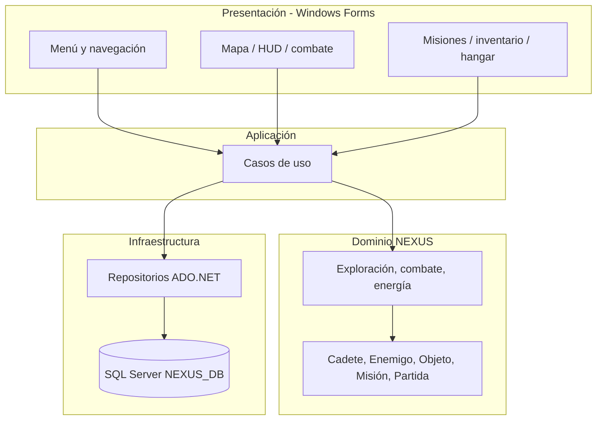

# Arquitectura propuesta para NEXUS

## 1. Objetivo

Evolucionar el código existente hacia una aplicación de escritorio Windows Forms sin reescribir las reglas del juego dentro de los formularios. La interfaz debe mostrar el estado; los servicios deben aplicar reglas; los repositorios deben comunicarse con SQL Server.

## 2. Capas

### Presentación — Windows Forms

Responsabilidad: recibir acciones del jugador y presentar el estado.

Formularios o controles propuestos:

- `MainForm`: navegación general.
- `MenuView`: menú principal.
- `RegistroOperativoView`: nombre y selección de clase.
- `HangarView`: equipo y mejoras.
- `MapaView`: escenario y HUD.
- `MisionesView`: objetivos y recompensas.
- `InventarioView`: objetos y equipo.

La primera entrega estable mantiene un solo jugador. Los formularios no deben contener consultas SQL ni reglas como calcular daño o validar recompensas.

### Dominio — reglas de NEXUS

Clases a extraer y adaptar desde H3 y H4:

- `Personaje`, `Cadete`, `Enemigo`, `Robot`, `Objeto`.
- `Mision`, `ObjetivoMision`, `Sector`, `Partida`.
- `CombateService`, `ExploracionService`, `InventarioService`, `ProgresionService`.

Esta capa controla salud, energía, movimiento, inventario, eventos, combate, objetivos y recompensas. No depende de controles de Windows Forms ni de SqlConnection.

### Aplicación

Coordina casos de uso entre la interfaz, el dominio y los repositorios:

- `IniciarPartida`
- `CargarPartida`
- `GuardarPartida`
- `CompletarMision`
- `ConsultarProgreso`

Puede usar servicios de aplicación para validar la acción y devolver un resultado que la interfaz pueda mostrar.

### Infraestructura — SQL Server

- `NexusDbContext` no es necesario si se elige ADO.NET directo; para esta etapa se recomienda una clase de conexión y repositorios con `Microsoft.Data.SqlClient`.
- `JugadorRepository`: alta y consulta de jugadores.
- `PartidaRepository`: crear, guardar y recuperar partidas.
- `InventarioRepository`: persistir objetos de la partida.
- `MisionRepository`: persistir estados y objetivos.

Las consultas deben usar parámetros SQL, conexiones abiertas solo durante la operación y bloques `using`. La cadena de conexión debe configurarse fuera del código fuente.

## 3. Diagrama de arquitectura



## 4. Relación entre lo actual y lo propuesto

| Código actual | Destino recomendado |
|---|---|
| `Personaje`, `Cadete`, `Enemigo`, `Robot`, `Objeto` en `Program.cs` | Proyecto/carpeta `Domain/Entities` |
| Métodos estáticos de `Program` | Servicios de dominio y casos de uso |
| Clases internas de `Form1.cs` | Modelos del dominio, no anidados en el formulario |
| `ConstruirPantalla...` | Vistas/formularios de presentación |
| `BtnAtacar_Click` y eventos similares | Controladores de interfaz que llaman a servicios |
| Dibujo y animación de `Form1.cs` | Controles gráficos dedicados, por ejemplo `GameCanvas` |
| Registro SQL descrito en `SQL_SERVER.md` | `JugadorRepository` |
| Futuro guardado de partida | `PartidaRepository` y tablas relacionadas |

La extracción debe ser gradual: primero modelos y reglas, luego persistencia, después formularios separados. Así se conserva la lógica de H3 y se reduce el riesgo de romper el prototipo gráfico.

## 5. Organización de solución sugerida

```text
NEXUS/
├── NEXUS.sln
├── src/
│   ├── Nexus.WinForms/
│   │   ├── Forms/
│   │   ├── Controls/
│   │   └── Program.cs
│   ├── Nexus.Domain/
│   │   ├── Entities/
│   │   └── Services/
│   ├── Nexus.Application/
│   │   └── UseCases/
│   └── Nexus.Infrastructure/
│       ├── Data/
│       └── Repositories/
├── database/
├── docs/
└── tests/
```

Esta es una estructura objetivo, no la estructura que ya tiene el repositorio. Se recomienda adoptarla en una etapa posterior, una vez asegurada la compilación del proyecto actual.

## 6. Decisiones de implementación

1. Mantener C# y Windows Forms porque el prototipo gráfico ya utiliza `Form`, `Panel`, eventos, temporizadores y `System.Drawing`.
2. Mantener el modo individual como flujo principal.
3. No ejecutar consultas SQL desde el temporizador gráfico ni desde eventos de dibujo.
4. Guardar una instantánea coherente de la partida al terminar misión o cuando el jugador elija guardar.
5. Usar transacciones al guardar una partida y sus elementos relacionados.
6. Probar reglas del dominio sin abrir formularios ni necesitar SQL Server.
