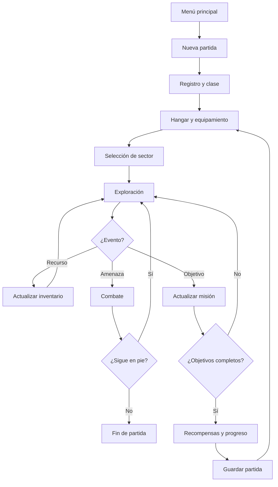

# Diseño del videojuego NEXUS

**Versión documental:** propuesta de evolución posterior a H3 y H4  
**Plataforma objetivo:** PC con Windows · C# · Windows Forms · SQL Server  
**Modo prioritario:** un jugador

## 1. Visión del juego

NEXUS es un videojuego de ciencia ficción y exploración táctica. El jugador controla a un operativo enviado a sectores peligrosos para recuperar recursos, cumplir objetivos y detener amenazas que ponen en riesgo una instalación futurista.

La propuesta conserva elementos que ya existen en H3: el cadete, sus roles, salud, energía, experiencia, inventario, coordenadas, exploración por sectores, encuentros aleatorios y la misión del Núcleo Energético. La evolución gráfica amplía esa base con selección de clases, mapas con identidad visual, combate en tiempo real, armas ficticias, mejoras, créditos, habilidades, jetpack y jefes.

La motivación para continuar será descubrir nuevos sectores, completar misiones, conseguir recursos, mejorar al operativo y superar encuentros de dificultad creciente. La campaña se organizará en misiones cortas con objetivos claros y recompensas visibles.

**Límite de esta propuesta:** el documento describe el diseño y la evolución prevista; no afirma que todas las pantallas o funciones estén terminadas ni que el guardado de partidas esté implementado.

## 2. Ciclo principal de juego

1. El jugador inicia NEXUS y consulta el menú.
2. Crea una partida individual e introduce el nombre del operativo.
3. Selecciona una clase: VANGUARD, SPECTRE o NETRUNNER.
4. Revisa el hangar, el equipo inicial y la dificultad.
5. Selecciona un sector y lee su efecto especial y objetivo.
6. Explora el mapa, se desplaza y administra salud, energía y recursos.
7. Enfrenta amenazas, utiliza habilidades y recoge recompensas.
8. Completa el objetivo del sector y derrota al jefe cuando corresponda.
9. Recibe experiencia y créditos; puede comprar o mejorar equipo.
10. Guarda el progreso cuando la persistencia esté integrada y comienza la siguiente misión.

## 3. Mecánicas y reglas

### Exploradores

El jugador comienza con un operativo. Las clases existentes en la interfaz gráfica tienen perfiles distintos:

- **VANGUARD:** mayor resistencia y reducción de daño.
- **SPECTRE:** movilidad y probabilidad de impacto crítico.
- **NETRUNNER:** energía y habilidades de apoyo.

En la primera versión estable se controla un solo operativo. La selección de dos jugadores que aparece en parte del código gráfico se considera experimental y queda fuera del alcance prioritario; el modo cooperativo se deja para una etapa posterior.

### Mapas y exploración

H3 utiliza un mapa lógico de 5 × 5 sectores, con coordenadas X/Y y descripciones de cada zona. La interfaz posterior representa la exploración en escenarios 2D con desplazamiento lateral, fondo con paralaje y elementos visuales. La propuesta conserva la identidad de los sectores y sus objetivos, pero permite que cada mapa tenga ambientación, color y efecto propio.

### Salud, energía y recursos

- La salud representa la capacidad del operativo para continuar.
- La energía se consume al usar habilidades y ciertas acciones.
- Los botiquines y recursos recuperan atributos según su tipo.
- Los créditos permiten adquirir mejoras en el hangar.
- La experiencia permite progresar y mejorar equipo o habilidades.

Las reglas deben impedir valores negativos o superiores a los máximos definidos. Cada acción debe mostrar su coste antes de confirmarse cuando sea posible.

### Misiones

La misión original de H3 consiste en localizar el Núcleo Energético en las coordenadas (4,4) y regresar al punto de extracción (0,0). La evolución la presenta como objetivos visibles, con estados pendiente, en curso y completado. Las nuevas misiones podrán reutilizar la misma estructura: explorar, recuperar un recurso, activar un punto y superar una amenaza principal.

### Inventario y equipamiento

El inventario muestra nombre, tipo y efecto de cada objeto. El jugador puede consumir recursos y equipar elementos compatibles. La interfaz debe diferenciar objetos disponibles, equipados y consumibles, y confirmar las acciones que gasten recursos.

### Combate y jefes

La versión gráfica incorpora movimiento, proyectiles, habilidades, curación, recarga, enemigos y encuentros con jefes. En la dificultad máxima se plantea una secuencia de tres jefes, como se trabajó en la evolución de H4. Los patrones se diseñarán como comportamientos ficticios del videojuego, con señales visuales claras y ventanas para reaccionar.

## 4. Diseño de pantallas

Los bocetos legibles están en [evidencias/wireframes.md](evidencias/wireframes.md). Cubren cuatro pantallas obligatorias y describen su navegación:

1. Menú principal: nueva partida, continuar (cuando exista guardado), opciones y salir.
2. Exploración/mapa: escenario, operativo, HUD de salud/energía, objetivo, minimapa y pausa.
3. Misiones: objetivo actual, objetivos secundarios, progreso y recompensas.
4. Exploradores/inventario: clase, atributos, objetos, equipo y acciones.

La navegación mantiene un botón de regreso o pausa reconocible. No se debe obligar al jugador a cerrar la aplicación para cambiar entre pantallas.

## 5. Experiencia de usuario

- **Legibilidad:** tipografía clara, tamaño cómodo y contraste alto entre texto y fondo.
- **Jerarquía:** objetivo y estado del operativo siempre visibles; información secundaria en paneles.
- **Consistencia:** mismos colores para salud, energía, créditos, selección y alertas en todas las pantallas.
- **Navegación:** botones con verbos concretos, rutas cortas y posibilidad de volver.
- **Retroalimentación:** mostrar qué ocurrió después de recoger un objeto, gastar energía, recibir daño, completar un objetivo o comprar una mejora.
- **Accesibilidad básica:** no depender solo del color; acompañar los estados con texto o iconos y permitir control por teclado.
- **Rendimiento:** evitar consultas a SQL Server dentro del ciclo de dibujo o animación.

## 6. Alcance y restricciones

### Prioridad de la siguiente etapa

1. Dejar una aplicación Windows Forms compilable y con un punto de entrada claro.
2. Mantener el modo de un jugador.
3. Separar la lógica del juego del código que dibuja la interfaz.
4. Conservar clases, mapas, roles, recursos y reglas que ya existen.
5. Registrar jugadores y diseñar el guardado/recuperación de partidas en SQL Server.
6. Añadir pruebas para reglas principales y persistencia.

### Opcional o posterior

- Cooperativo o multijugador.
- Más sectores, campañas y clases.
- Logros, estadísticas ampliadas y personalización cosmética.
- Sonido, música y opciones avanzadas.

### Restricciones

- No reemplazar NEXUS por un juego distinto: la base funcional y conceptual es H3.
- No afirmar que la persistencia completa existe: en el repositorio se verifica la tabla Jugadores, no una tabla de partidas.
- No guardar contraseñas ni secretos en el repositorio.
- La cadena de conexión local debe configurarse por entorno.
- La documentación técnica debe distinguir lo implementado, lo experimental y lo propuesto.
- Windows Forms está orientado a escritorio Windows; no es una solución multiplataforma.
