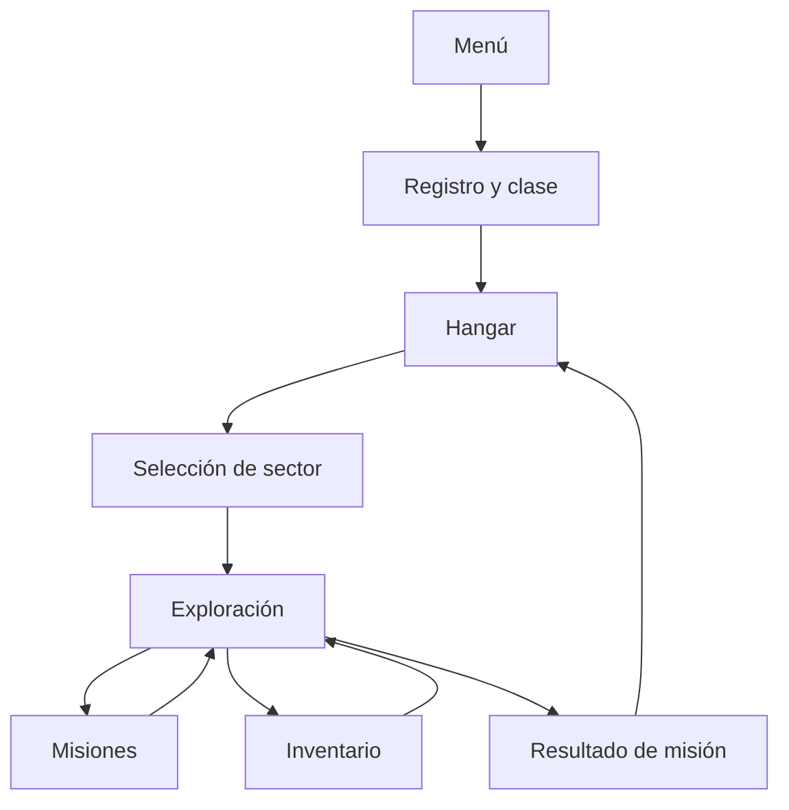

# Evidencias de diseño: wireframes de NEXUS

Estos bocetos son esquemas funcionales de distribución. No son capturas de una aplicación terminada. Se elaboraron para definir qué verá el jugador y cómo navegará.

## 1. Menú principal

```text
┌──────────────────────────────────────────────────────────────┐
│                         N E X U S                              │
│                  PROTOCOLO OMEGA · PC EDITION                  │
│                                                              │
│                 [ FONDO: BASE / SECTOR ]                       │
│                                                              │
│                    ┌──────────────────┐                        │
│                    │   NUEVA PARTIDA  │                        │
│                    ├──────────────────┤                        │
│                    │ CONTINUAR*       │                        │
│                    ├──────────────────┤                        │
│                    │ OPCIONES         │                        │
│                    ├──────────────────┤                        │
│                    │ SALIR            │                        │
│                    └──────────────────┘                        │
│                                                              │
│  *Continuar se habilita cuando guardar/cargar esté integrado. │
└──────────────────────────────────────────────────────────────┘
```

**Acciones:** Nueva partida abre registro; Continuar carga la última partida disponible; Opciones muestra controles y sonido; Salir solicita confirmación.

## 2. Exploración / mapa

```text
┌──────────────────────────────────────────────────────────────┐
│ NEXUS / SECTOR 01                       [PAUSA] [MAPA]         │
├──────────────────────────────────────────────────────────────┤
│ SALUD █████████░░   ENERGÍA ███████░░░   CRÉDITOS: 180         │
│                                                              │
│ ┌──────────────────────────────────────────────┐ ┌──────────┐ │
│ │                                              │ │ RADAR    │ │
│ │          ESCENARIO 2D / PIXEL ART            │ │   ·      │ │
│ │                                              │ │ · P ·    │ │
│ │       OPERATIVO →       ENEMIGO              │ │   ·      │ │
│ │                                              │ └──────────┘ │
│ └──────────────────────────────────────────────┘              │
│ OBJETIVO: Explora el sector y localiza la señal.               │
│ [ATACAR] [HABILIDAD] [CURAR] [RECARGAR] [INVENTARIO]           │
│ Mensajes: recurso recogido / daño recibido / misión actualizada│
└──────────────────────────────────────────────────────────────┘
```

**Acciones:** WASD o flechas para moverse; Espacio para saltar según el modo; botones para acciones; P para pausar. El HUD se actualiza después de cada acción.

## 3. Misiones

```text
┌──────────────────────────────────────────────────────────────┐
│ NEXUS / REGISTRO DE MISIONES                    [VOLVER]       │
├──────────────────────────────────────────────────────────────┤
│ MISIÓN PRINCIPAL: LA ANOMALÍA PERDIDA                          │
│                                                              │
│ [✓] Registrar operativo                                      │
│ [✓] Llegar al sector de la señal                             │
│ [ ] Recuperar el Núcleo Energético                            │
│ [ ] Regresar al punto de extracción                           │
│                                                              │
│ PROGRESO  ███████░░░  2 / 4                                   │
│                                                              │
│ RECOMPENSA PREVISTA: experiencia y créditos                   │
│                                                              │
│                         [IR AL MAPA]                           │
└──────────────────────────────────────────────────────────────┘
```

**Acciones:** seleccionar misión para ver detalles; Ir al mapa inicia o retoma el objetivo; al completar un paso, su estado cambia y aparece una notificación.

## 4. Explorador / inventario

```text
┌──────────────────────────────────────────────────────────────┐
│ NEXUS / OPERATIVO E INVENTARIO                 [VOLVER]        │
├──────────────────────────────┬───────────────────────────────┤
│ PERFIL                       │ INVENTARIO                    │
│                              │                               │
│ [RETRATO / SPRITE]           │ • Célula de energía      x2   │
│ VANGUARD                     │ • Botiquín               x1   │
│ Salud: 240                   │ • Objeto de equipo       x1   │
│ Energía: 115                 │                               │
│ Experiencia: 0               │ EQUIPAMIENTO                  │
│ Créditos: 180                │ Arma: Pistola de pulso        │
│                              │ Armadura: Básica              │
│ HABILIDAD                    │                               │
│ Barrera de plasma            │ [USAR] [EQUIPAR] [DETALLES]    │
│                              │                               │
│ [HANGAR] [MEJORAS]           │                               │
└──────────────────────────────┴───────────────────────────────┘
```

**Acciones:** elegir un objeto muestra su descripción; Usar consume un recurso; Equipar cambia el equipo activo; Hangar permite comprar mejoras si hay créditos suficientes.

## 5. Navegación entre pantallas



La pausa debe permitir volver al juego, consultar controles o salir al menú con confirmación. Los botones principales conservarán posición y estilo para que el jugador aprenda la navegación una sola vez.
