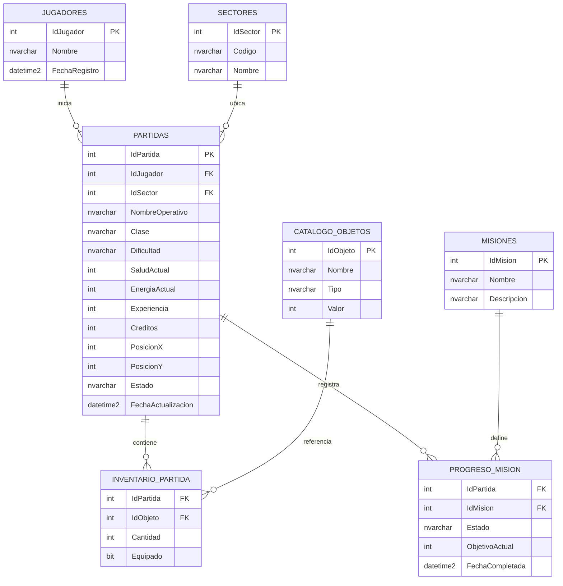

# Modelo de datos propuesto para NEXUS

## 1. Estado actual

El script `database/NEXUS_DB.sql` crea la base `NEXUS_DB` y una tabla `dbo.Jugadores` con:

- `IdJugador`: clave primaria autonumérica.
- `Nombre`: nombre del jugador.

El repositorio no contiene todavía tablas verificadas para partidas, inventario, misiones o progreso. El siguiente modelo es una propuesta de evolución; no debe confundirse con el esquema actualmente desplegado.

## 2. Entidades propuestas

### Jugador

Identifica al usuario que inicia una o más partidas.

- `IdJugador` (PK)
- `Nombre`
- `FechaRegistro`

### Partida

Representa una sesión guardable del modo individual.

- `IdPartida` (PK)
- `IdJugador` (FK)
- `NombreOperativo`
- `Clase`
- `Dificultad`
- `SectorActual`
- `SaludActual`, `EnergiaActual`
- `Experiencia`, `Creditos`
- `PosicionX`, `PosicionY`
- `Estado` (EnCurso, Completada o Abandonada)
- `FechaCreacion`, `FechaActualizacion`

### CatalogoObjeto e InventarioPartida

`CatalogoObjeto` define los objetos disponibles; `InventarioPartida` registra qué objetos posee cada partida y cuántas unidades tiene. La tabla de inventario incluye si el objeto está equipado.

### Mision y ProgresoMision

`Mision` contiene la definición de una misión. `ProgresoMision` guarda el estado de esa misión dentro de una partida, incluyendo objetivo actual y fecha de finalización.

### Sector

Catálogo de mapas o sectores. La partida guarda el sector actual mediante su identificador o código.

## 3. Relaciones

- Un jugador puede tener muchas partidas (1:N).
- Una partida puede contener muchos objetos de inventario (1:N).
- Un objeto del catálogo puede aparecer en muchas partidas (1:N hacia InventarioPartida).
- Una partida puede registrar el progreso de varias misiones (1:N).
- Una misión puede aparecer en muchas partidas (1:N).
- Un sector puede ser el sector actual de muchas partidas (1:N).



## 4. Estrategia de guardado y recuperación

1. El jugador se registra o se selecciona mediante `IdJugador`.
2. Al iniciar una campaña se crea una fila en `Partidas`.
3. Al guardar, la aplicación obtiene una instantánea del estado del dominio.
4. Dentro de una transacción SQL actualiza `Partidas`, reemplaza o sincroniza `InventarioPartida` y actualiza `ProgresoMision`.
5. Al continuar, consulta la partida por `IdPartida`, carga inventario y misiones relacionadas y reconstruye el objeto de dominio.
6. Si una operación falla, la transacción se revierte para evitar una partida parcialmente guardada.

El guardado se debe realizar en momentos definidos: al elegir Guardar, al completar una misión y al salir de forma controlada. No se debe guardar en cada frame de animación.

## 5. SQL de referencia para la ampliación futura

El siguiente script es una propuesta de esquema inicial. Se debe revisar y probar en una base de desarrollo antes de usarlo con datos reales. No modifica el script actual de forma automática.

```sql
USE NEXUS_DB;
GO

IF OBJECT_ID('dbo.Sectores', 'U') IS NULL
CREATE TABLE dbo.Sectores (
    IdSector INT IDENTITY(1,1) PRIMARY KEY,
    Codigo NVARCHAR(30) NOT NULL UNIQUE,
    Nombre NVARCHAR(100) NOT NULL
);
GO

IF OBJECT_ID('dbo.Partidas', 'U') IS NULL
CREATE TABLE dbo.Partidas (
    IdPartida INT IDENTITY(1,1) PRIMARY KEY,
    IdJugador INT NOT NULL,
    IdSector INT NULL,
    NombreOperativo NVARCHAR(100) NOT NULL,
    Clase NVARCHAR(30) NOT NULL,
    Dificultad NVARCHAR(20) NOT NULL,
    SaludActual INT NOT NULL,
    EnergiaActual INT NOT NULL,
    Experiencia INT NOT NULL DEFAULT 0,
    Creditos INT NOT NULL DEFAULT 0,
    PosicionX INT NOT NULL DEFAULT 0,
    PosicionY INT NOT NULL DEFAULT 0,
    Estado NVARCHAR(20) NOT NULL DEFAULT 'EnCurso',
    FechaCreacion DATETIME2 NOT NULL DEFAULT SYSDATETIME(),
    FechaActualizacion DATETIME2 NOT NULL DEFAULT SYSDATETIME(),
    CONSTRAINT FK_Partidas_Jugadores FOREIGN KEY (IdJugador)
        REFERENCES dbo.Jugadores(IdJugador),
    CONSTRAINT FK_Partidas_Sectores FOREIGN KEY (IdSector)
        REFERENCES dbo.Sectores(IdSector),
    CONSTRAINT CK_Partidas_Salud CHECK (SaludActual >= 0),
    CONSTRAINT CK_Partidas_Energia CHECK (EnergiaActual >= 0)
);
GO

IF OBJECT_ID('dbo.CatalogoObjetos', 'U') IS NULL
CREATE TABLE dbo.CatalogoObjetos (
    IdObjeto INT IDENTITY(1,1) PRIMARY KEY,
    Nombre NVARCHAR(100) NOT NULL,
    Tipo NVARCHAR(30) NOT NULL,
    Valor INT NOT NULL DEFAULT 0
);
GO

IF OBJECT_ID('dbo.InventarioPartida', 'U') IS NULL
CREATE TABLE dbo.InventarioPartida (
    IdPartida INT NOT NULL,
    IdObjeto INT NOT NULL,
    Cantidad INT NOT NULL DEFAULT 1,
    Equipado BIT NOT NULL DEFAULT 0,
    CONSTRAINT PK_InventarioPartida PRIMARY KEY (IdPartida, IdObjeto),
    CONSTRAINT FK_Inventario_Partidas FOREIGN KEY (IdPartida)
        REFERENCES dbo.Partidas(IdPartida) ON DELETE CASCADE,
    CONSTRAINT FK_Inventario_Objetos FOREIGN KEY (IdObjeto)
        REFERENCES dbo.CatalogoObjetos(IdObjeto),
    CONSTRAINT CK_Inventario_Cantidad CHECK (Cantidad > 0)
);
GO

IF OBJECT_ID('dbo.Misiones', 'U') IS NULL
CREATE TABLE dbo.Misiones (
    IdMision INT IDENTITY(1,1) PRIMARY KEY,
    Codigo NVARCHAR(30) NOT NULL UNIQUE,
    Nombre NVARCHAR(120) NOT NULL,
    Descripcion NVARCHAR(500) NULL
);
GO

IF OBJECT_ID('dbo.ProgresoMision', 'U') IS NULL
CREATE TABLE dbo.ProgresoMision (
    IdPartida INT NOT NULL,
    IdMision INT NOT NULL,
    Estado NVARCHAR(20) NOT NULL DEFAULT 'Pendiente',
    ObjetivoActual INT NOT NULL DEFAULT 0,
    FechaCompletada DATETIME2 NULL,
    CONSTRAINT PK_ProgresoMision PRIMARY KEY (IdPartida, IdMision),
    CONSTRAINT FK_Progreso_Partidas FOREIGN KEY (IdPartida)
        REFERENCES dbo.Partidas(IdPartida) ON DELETE CASCADE,
    CONSTRAINT FK_Progreso_Misiones FOREIGN KEY (IdMision)
        REFERENCES dbo.Misiones(IdMision)
);
GO
```

## 6. Reglas de integridad y seguridad

- Las claves primarias identifican cada registro y las claves foráneas mantienen relaciones válidas.
- Las cantidades y atributos no deben aceptar valores fuera de las reglas del juego.
- Las consultas deben usar parámetros, por ejemplo `@IdJugador`, y tipos SQL explícitos.
- La cadena de conexión no debe quedar fijada al nombre de un equipo personal.
- Las operaciones que actualizan varias tablas deben usar transacciones.
- No almacenar información personal innecesaria: para esta versión basta con el nombre elegido dentro del juego.
